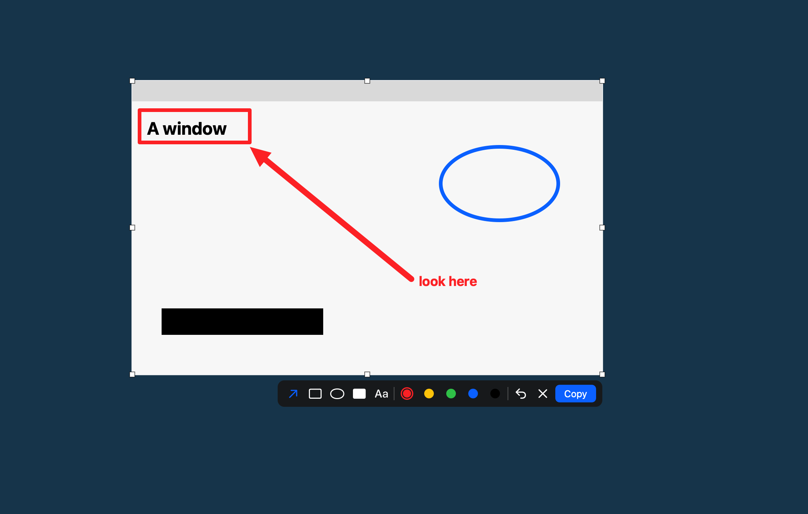

# IgSnap

A small native Mac screenshot app. Run it and the screen freezes: click a window or drag a region, draw on it,
copy it. Then it quits. No hotkey, no menu bar item; whatever launches it is the trigger.



## Use

```
just install      # build, sign, copy to /Applications
open -a IgSnap
```

The first run asks for Screen Recording permission (System Settings → Privacy & Security). Grant it and run again.

| | |
| --- | --- |
| Hover, click | Take the window under the pointer |
| Drag | Take a region. Handles adjust it; dragging outside starts over |
| `A` `R` `E` `B` `T` | Arrow, rectangle, ellipse, black-out box, text |
| ⌘Z | Undo |
| Return or ⌘C | Copy and quit |
| Esc or right-click | Quit |

## Develop

```
just test         # core tests: geometry, hit-testing, rendering
just selftest     # the overlay's mouse and key handlers, driven headless
just demo         # draw the overlay to build/demo.png, off screen, no permission needed
just run          # build and take a screenshot
```

Needs macOS 27 and the Xcode toolchain. Design notes and what is left: [PLAN.md](PLAN.md).
